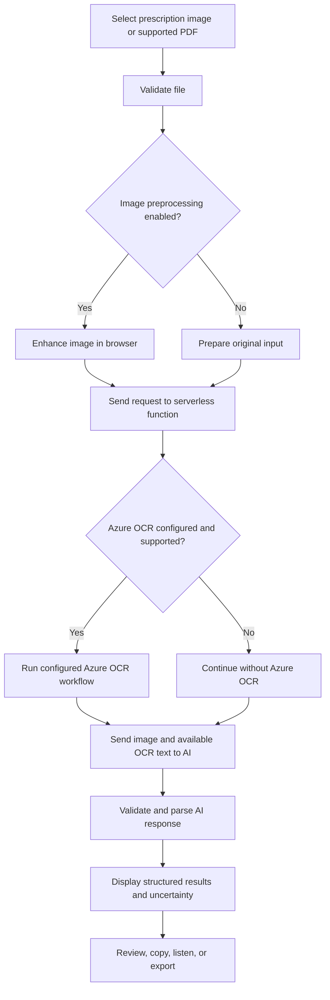
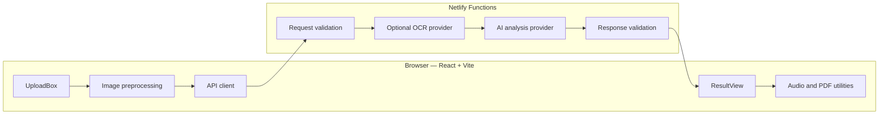

::: {align="center"}
# MedScript Analyzer

### AI-Assisted Medical Prescription Text Extraction

Turn prescription images into structured, easier-to-review text with
OCR, vision-based AI analysis, image enhancement, audio explanations,
and PDF export.

```{=html}
<p>
```
``{=html}
``{=html}
``{=html}
``{=html}
``{=html}
```{=html}
</p>
```
**Portfolio project** exploring computer vision, OCR, image
preprocessing, structured AI extraction, and serverless deployment.
:::\(!IMPORTANT\) Educational use only --- not medical advice. OCR
and AI can misread medicine names, strengths, and instructions. Never
use this application to make treatment decisions. Confirm every result
with a qualified doctor or pharmacist.

Table of contents
- Overview
- Features
- How it works
- Architecture
- Technology stack
- Project structure
- Requirements
- Run locally on Windows
- Environment variables
- Optional Azure OCR setup
- Run and test
- Deploy to Netlify
- Troubleshooting
- Security and privacy
- Limitations
- Future improvements
- Learning outcomes
- License
Overview
MedScript Analyzer is a web application designed to help users
inspect text extracted from medical prescription images and supported
PDF files. It combines image preprocessing, OCR where configured, and a
vision-capable AI provider to organize readable information into a
structured result.

The application is intended as a software engineering and AI learning
project. It is not a validated clinical system, does not verify
prescriptions, and cannot guarantee the correctness of extracted
information.
Project links
- Live demo: Add your verified Netlify URL here.
- Source code: Add your GitHub repository URL here.
- Screenshots: Add genuine screenshots from your running
  application in a docs/screenshots/ folder.
Do not publish placeholder links as though they were real deployments.
Features
The list below describes the intended project capabilities from the
current project documentation. Confirm each item against the code and
provider configuration before representing it as production-ready.
<details open>
<summary>
<strong>{=html}Upload and image preparation</strong>{=html}
</summary>
- Upload supported image files: JPG, JPEG, PNG, and WEBP.
- PDF support depends on the configured analysis flow.
- Drag-and-drop upload and image preview.
- Client-side Canvas processing options, including contrast
  adjustment, sharpening, grayscale conversion, and resizing, where
  implemented.
- Original/enhanced preview for visual comparison.
- File-size and file-type validation.
</details>
<details>
<summary>
<strong>{=html}AI-assisted extraction</strong>{=html}
</summary>
- Vision-based analysis using a configured Google Gemini model.
- Optional secondary provider support for NVIDIA NIM, if enabled in
  the backend.
- Structured fields for patient and prescriber details, medicines,
  dosage, frequency, timing, duration, and instructions when legible.
- Unclear or missing values should be marked as uncertain rather than
  guessed.
- Clearly labelled demo data when demo mode is enabled.
</details>
<details>
<summary>
<strong>{=html}Optional OCR enhancement</strong>{=html}
</summary>
- Optional Microsoft Azure AI Vision OCR integration.
- Display of raw OCR text only when it was actually returned by the
  OCR provider.
- OCR-assisted analysis where supported by the configured endpoint and
  file type.
- A fallback path when OCR is not configured or fails, provided the
  backend implements it.
OCR is not guaranteed to read handwritten medical instructions
accurately. Always check the original prescription.

</details>
<details>
<summary>
<strong>{=html}Review and export</strong>{=html}
</summary>
- Copy extracted text to the clipboard.
- Browser-based text-to-speech using the Web Speech API, where
  supported.
- PDF report generation using jsPDF, where implemented.
- Structured medicine and instruction cards.
- Clear uncertainty notices and medical safety messaging.
</details>
How it works

The diagram represents the intended workflow. Exact behavior depends on
the code and environment variables configured in your deployment.
Architecture

Data flow
1. The user selects a file and reviews its preview.
2. Optional preprocessing runs in the browser.
3. The frontend sends the analysis request to a serverless function.
4. If configured and supported, the backend runs OCR and passes the
   available text to the AI analysis stage.
5. The backend validates the provider response and returns structured
   results.
6. The frontend displays the result and offers supported review/export
   controls.
Keep API credentials on the server. Do not put secret keys in Vite
variables prefixed with VITE_, because those values can be included in
the client bundle.
Technology stack
  Layer                   Technology              Purpose
  Frontend                React 18                Component-based UI

  Build tool              Vite                    Development server and
                                                  production build

  Styling                 Tailwind CSS 4          Responsive styling

  Backend                 Netlify Functions /     Server-side API
                          Node.js                 requests

  Primary AI              Google Gemini API       Vision-based
                                                  extraction, if
                                                  configured

  Optional OCR            Microsoft Azure AI      OCR preprocessing, if
                          Vision                  configured

  Optional AI provider    NVIDIA NIM              Alternative provider,
                                                  if implemented and
                                                  configured

  Image processing        Browser Canvas API      Client-side image
                                                  enhancement

  PDF export              jsPDF                   Client-generated
                                                  report, if implemented

  Audio                   Web Speech API          Browser text-to-speech

  Hosting                 Netlify                 Static hosting and
                                              serverless functions
Use the versions in package.json as the source of truth if they differ
from this overview.
Project structure
medical-prescription-analyzer/
├── netlify/
│   └── functions/
│       └── analyze.js
├── samples/
├── src/
│   ├── components/
│   │   ├── AudioPlayer.jsx
│   │   ├── Disclaimer.jsx
│   │   ├── Footer.jsx
│   │   ├── Header.jsx
│   │   ├── Hero.jsx
│   │   ├── HowItWorks.jsx
│   │   ├── Loader.jsx
│   │   ├── MedicineCard.jsx
│   │   ├── ResultView.jsx
│   │   └── UploadBox.jsx
│   ├── lib/
│   │   ├── api.js
│   │   ├── imagePreprocess.js
│   │   └── pdf.js
│   ├── App.jsx
│   ├── index.css
│   └── main.jsx
├── .env.example
├── .gitignore
├── index.html
├── netlify.toml
├── package.json
└── vite.config.js
This is the documented target structure. If your current repository
differs, update this tree to match the files that actually exist.
Requirements
- Windows 10/11, macOS, or Linux.
- Node.js version supported by the installed Vite and project
  dependencies. Check package.json; use a currently supported
  Node.js LTS release.
- npm.
- A Google Gemini API key for real AI analysis, if Gemini is the
  configured provider.
- Optional Azure AI Vision credentials for OCR, if that integration is
  implemented.
- Optional NVIDIA NIM credentials, if that provider is implemented.
Run locally on Windows
Open PowerShell or Command Prompt:
cd "C:\Users\ASUS\Desktop\medical prescription analyzer"

# Install dependencies
npm install

# Create the local environment file
Copy-Item .env.example .env

# Edit environment variables
notepad .env

# Start the development server
npm run dev
Open the local URL printed by Vite, commonly http://localhost:5173.

The project may proxy the Netlify function locally through
vite.config.js. Confirm that this middleware exists and is enabled. If
it does not, use the development method documented by your actual
configuration rather than assuming the function endpoint will work
automatically.

To create a production build:
npm run build
Run linting or tests only if corresponding scripts exist in
package.json:
npm run
This lists the scripts available in the project.
Environment variables
Create a local .env file from .env.example. Use empty values for
integrations you are not enabling.
# Server-side secret — required for real Gemini analysis
GEMINI_API_KEY=

# Optional alternative AI provider, if implemented
NVIDIA_API_KEY=

# Optional Azure OCR integration, if implemented
AZURE_CV_ENDPOINT=
AZURE_CV_KEY=
  Variable                Purpose                 Required?
  GEMINI_API_KEY        Authenticates Gemini    For real Gemini
                          requests from the       analysis
                          server                  

  NVIDIA_API_KEY        Authenticates NVIDIA    Only if using NVIDIA
                          NIM requests            

  AZURE_CV_ENDPOINT     Azure resource endpoint Only if using Azure OCR
  AZURE_CV_KEY          Azure resource key      Only if using Azure OCR
Credential safety checklist
- Keep .env out of Git.
- Commit .env.example with blank values only.
- Never paste API keys into source code, README files, screenshots, or
  public issues.
- Configure production secrets in Netlify's environment-variable
  settings.
- If a key was ever committed or shared, revoke/rotate it immediately;
  deleting the visible copy alone is not enough.
- Do not assume a provider is free or that usage is unlimited. Check
  its current pricing, quotas, and eligibility before use.
Optional Azure OCR setup
Azure OCR is an optional enhancement, not a prerequisite for the
frontend or for other configured AI analysis paths.
1. Sign in to the Azure portal.
2. Create or select an Azure AI Vision resource that supports the OCR
   API you intend to use.
3. Open the resource's Keys and Endpoint page.
4. Copy the endpoint and a key into your local .env file.
5. Verify the exact OCR API, API version, endpoint path, authentication
   header, request payload, and response schema against the official
   documentation for that resource.
6. Test a non-sensitive sample image before using any real document.
7. Confirm the UI reports Azure OCR as used only when the OCR request
   succeeds.
Important API distinction: Azure's Read OCR workflow and Image
Analysis APIs can have different endpoints, request formats, response
formats, and operation-status behavior. Do not describe an asynchronous
Read API as a synchronous Image Analysis call. Implement and document
the API workflow that the source code actually uses. PDF support must be
verified separately; do not assume an image OCR endpoint accepts PDF
files.

Official starting points:
- Azure AI Vision
  documentation
- Azure AI Vision OCR
  documentation
Run and test
Use synthetic or deliberately non-sensitive sample documents for
development.
  Scenario                            Expected behavior to verify
  Clear prescription image            Extract legible fields and mark
                                      uncertainty appropriately

  Blurry or low-resolution image      Avoid guessing; identify unclear
                                      fields where possible

  Non-prescription image              Return a clear validation or
                                      analysis message

  Unsupported file type               Reject it with a useful error

  File over configured size limit     Reject it on both client and server

  Missing AI credentials              Show a clearly labelled demo state
                                      or configuration error, depending
                                      on implementation

  Invalid AI credentials              Show a useful error; do not
                                      silently return synthetic data

  Azure credentials absent            Continue without Azure OCR if the
                                      configured fallback supports it

  Azure OCR failure                   Report that OCR was unavailable and
                                      describe any actual fallback

  Malformed provider response         Handle safely without crashing the
                                      UI

  Provider timeout or rate limit      Display a recoverable error and
                                      avoid unsafe automatic retries

  Audio unavailable in browser        Keep text results usable and
                                      explain that audio is unsupported

  PDF export                          Verify that the downloaded report
                                      contains the correct current result

  Multiple rapid requests             Verify rate limiting and
                                  request-state handling
These are test cases, not claims that the tests have already passed.
Record actual results after running them.
Deploy to Netlify
1. Push the project to a Git repository.
2. Import the repository into Netlify.
3. Check the project's netlify.toml configuration.
4. Configure the build command and publish directory to match the
   project:
   - Build command: npm run build
   - Publish directory: dist
   - Functions directory: netlify/functions (if configured this
     way)
5. Add the required server-side environment variables in Netlify.
6. Deploy and inspect the function logs for errors. Do not log API keys
   or prescription contents.
7. Test the deployed site with a non-sensitive sample image.
8. Confirm the live URL, production AI configuration, optional OCR
   behavior, and error handling before adding a public demo link to
   this README.
Troubleshooting
<details>
<summary>
<strong>{=html}The app shows demo data</strong>{=html}
</summary>
Check whether the serverless function can read GEMINI_API_KEY. Restart
the local development server after changing .env. In production,
configure the key in Netlify and redeploy if required by the platform.

Demo data must be visibly labelled and must never be confused with real
prescription analysis.
</details>
<details>
<summary>
<strong>{=html}The analysis request fails</strong>{=html}
</summary>
Check the browser network panel and serverless function logs. Verify the
provider key, model identifier, endpoint, request format, quotas, and
supported input type. Redact sensitive values before sharing logs.
</details>
<details>
<summary>
<strong>{=html}Azure OCR does not run</strong>{=html}
</summary>
Verify both Azure environment variables, resource endpoint, key, API
version, supported file format, and the exact OCR workflow implemented
by the backend. Check whether the UI distinguishes "not configured,"
"failed," and "successfully completed."
</details>
<details>
<summary>
<strong>{=html}The local function endpoint returns
404</strong>{=html}
</summary>
Inspect vite.config.js, netlify.toml, and
netlify/functions/analyze.js. The frontend development server does not
automatically guarantee that Netlify functions are available locally.
</details>
<details>
<summary>
<strong>{=html}The production build fails</strong>{=html}
</summary>
Run npm install, inspect the first meaningful build error, and check
Node.js compatibility with the installed dependencies. Do not suppress
errors merely to make the build appear successful.
</details>
Security and privacy
Prescription images can contain sensitive personal and health
information.
- Send API credentials only from server-side code.
- Validate incoming requests and file limits on the server as well as
  the client.
- Avoid storing uploaded files or extracted text unless there is a
  clear, documented need.
- Do not log prescription images, OCR text, medicine lists, patient
  details, or secret keys.
- Verify actual retention and processing behavior across your
  application, hosting platform, and AI/OCR providers before claiming
  that data is never stored.
- Tell users when content is transmitted to third-party providers.
- Use non-sensitive sample documents for demonstrations and testing.
- Provide clear error handling without returning internal stack traces
  or secrets to the browser.
Medical safety disclaimer
MedScript Analyzer is an educational information-extraction project.
It is not a substitute for a doctor, pharmacist, or other qualified
healthcare professional.
- OCR can misread handwriting, abbreviations, numbers, and medicine
  names.
- AI may omit details or generate incorrect information.
- Drug interactions, contraindications, and side effects must not be
  treated as clinically verified unless validated through an
  appropriate, reliable clinical source and process.
- Never start, stop, substitute, or change a medicine or dosage based
  on this application's output.
- Confirm all medicine names, strengths, doses, frequencies, and
  durations against the original prescription with a qualified
  healthcare professional.
Limitations
1. Handwriting: Accuracy varies with handwriting style, image
   quality, lighting, and abbreviations.
2. AI reliability: Structured output does not guarantee factual
   correctness.
3. PDFs: Supported PDF formats, page counts, and extraction
   behavior depend on the actual provider integration.
4. Provider availability: Models, API versions, quotas, and pricing
   can change.
5. Serverless limits: Request size, execution duration,
   concurrency, and memory depend on the deployment platform and
   configuration.
6. Rate limiting: An in-memory counter may not reliably enforce a
   global per-IP limit across multiple serverless instances or cold
   starts.
7. No assumed persistence: Describe data retention only after
   verifying the behavior of the code and external providers.
8. Browser features: Speech synthesis and some file capabilities
   vary by browser and operating system.
Future improvements
- Add automated tests for file validation, AI response parsing, and
  failure paths.
- Add an accessible, step-by-step processing indicator tied to actual
  backend states.
- Improve keyboard navigation and screen-reader announcements.
- Add a review workflow that lets users compare extracted fields with
  the original document.
- Integrate verified medicine information from a reliable,
  appropriately licensed source instead of relying solely on
  generative AI for safety information.
- Add configurable retention controls only if secure storage is
  intentionally introduced.
- Add genuine application screenshots and a short demonstration video.
- Add deployment and test-status badges only after the corresponding
  workflows exist and pass.
Learning outcomes
This project can demonstrate practical experience with:
- React component design and responsive interfaces.
- File uploads and client-side image processing.
- OCR and vision-model API integration.
- Serverless backend functions and environment configuration.
- Parsing and validating structured AI output.
- Error handling, input validation, and secret management.
- PDF generation and browser text-to-speech.
- Responsible communication of uncertainty and AI limitations.
The project was built as a portfolio exercise connected to learning
about Microsoft Azure AI Vision. This description does not imply
Microsoft endorsement or certification of the application.
License
This project is described as using the MIT License. Include a LICENSE
file containing the MIT License text before presenting the repository as
MIT-licensed.
::: {align="center"}
**Built for learning, experimentation, and responsible AI development.**

If you find a technical issue, please open a GitHub issue without
uploading real prescriptions, personal health information, or API
credentials.
:::
